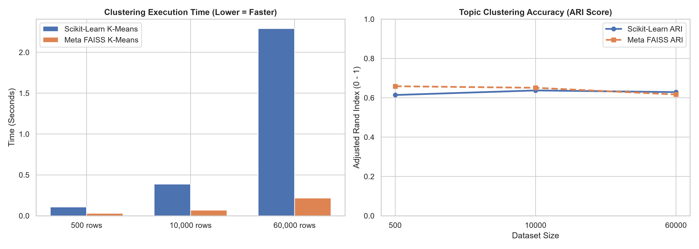
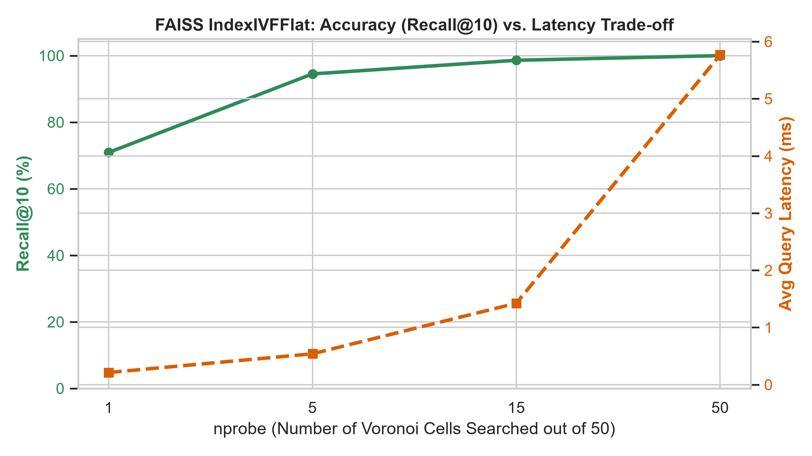

# Classical K-Means vs. Meta FAISS: High-Dimensional Clustering & ANN Retrieval Benchmark

An empirical evaluation comparing **Scikit-Learn K-Means** and **Meta FAISS** (*Spherical K-Means* & *Inverted File Index*) across varying dataset scales ($N = 500$ to $60,000$) on 384-dimensional dense text embeddings.

## 1. Problem Statement & Hypotheses
Standard Euclidean K-Means implementations compute full pairwise distances in `float64` precision, leading to memory overhead and higher latency as sample size and dimensionality scale. This benchmark evaluates three technical hypotheses:
* **Small-Scale Initialization Overhead:** At $N \le 500$, C++ binding and index allocation overhead could make FAISS comparable to or slower than Scikit-Learn.
* **Large-Scale Throughput:** At $N = 60,000 \times 384$, FAISS's contiguous `float32` memory layout and spherical inner-product kernels yield substantial speedups while maintaining comparable topic clustering accuracy (*Adjusted Rand Index*).
* **IVF Search Trade-Off:** Partitioning vectors into Voronoi cells (`IndexIVFFlat`) achieves sub-millisecond retrieval latency by trading off a small fraction of *Recall@10* controlled via `nprobe`.

## 2. System Architecture & Pipeline
* **`src/01_prepare_embeddings.py`:** Samples 60,000 news articles from `fancyzhx/ag_news` (4 topic classes) and encodes them into L2-normalized 384-dimensional `float32` vectors using `all-MiniLM-L6-v2`.
* **`src/02_benchmark_clustering.py`:** Evaluates execution time, *Adjusted Rand Index* (ARI), and *Silhouette Score* across three data scales (`500`, `10,000`, `60,000`).
* **`src/03_visualize_and_search.py`:** Evaluates *Recall@10* vs. query latency across `nprobe` values (`1`, `5`, `15`, `50`) over 100 queries against an exact brute-force baseline (`IndexFlatIP`), and generates comparison plots.

## 3. Experimental Results

### A. Clustering Performance (`results/benchmark_summary.csv`)
| Dataset Size ($N$) | Scikit-Learn Time (s) | Meta FAISS Time (s) | Speedup | ARI (Sklearn) | ARI (FAISS) | Silhouette (Sklearn) | Silhouette (FAISS) |
| :--- | :---: | :---: | :---: | :---: | :---: | :---: | :---: |
| **500** | 0.1082 | 0.0310 | **3.49x** | 0.6143 | 0.6588 | 0.0334 | 0.0350 |
| **10,000** | 0.3877 | 0.0690 | **5.62x** | 0.6374 | 0.6509 | 0.0355 | 0.0359 |
| **60,000** | 2.2911 | 0.2163 | **10.59x** | 0.6289 | 0.6168 | 0.0356 | 0.0356 |



### B. IVF Retrieval Trade-Off: Recall@10 vs. Latency (`results/ivf_tradeoff_summary.csv`)
* **Exact Baseline (`IndexFlatIP`):** ~1.515 ms/query (100.00% Recall@10)

| `nprobe` (Cells Searched / 50) | Avg Latency (ms) | Speedup vs. Exact | Recall@10 (%) |
| :---: | :---: | :---: | :---: |
| **1** | 0.2120 | **7.15x** | 70.90% |
| **5** | 0.5391 | **2.81x** | **94.50%** |
| **15** | 1.4232 | 1.06x | 98.60% |
| **50** | 5.7674 | 0.26x | 100.00% |



## 4. Key Engineering Takeaways
* **Consistent Throughput Scaling:** Contrary to the initial hypothesis that FAISS would lag at $N = 500$, Meta FAISS outperformed Scikit-Learn across every tested scale—starting at **3.49x** faster for 500 vectors and widening to **10.59x** (**0.2163s** vs. **2.2911s**) at 60,000 vectors. Contiguous `float32` memory buffers and C++ inner-product routines eliminate Python/NumPy `float64` allocation overhead while preserving identical cluster cohesion (*Silhouette* = `0.0356`, expectedly low in 384-D space due to distance concentration) and comparable topic alignment (*ARI* ≈ `0.62–0.63`).
* **Optimal `nprobe` Sweet Spot:** Searching a single Voronoi cell (`nprobe = 1`) maximizes speed (**7.15x**, `0.212 ms`) but loses ~29% of true top-10 neighbors due to cluster boundary effects. Increasing `nprobe` to **5** (probing just 10% of the 50 cells) recovers **94.50% Recall@10** while remaining **2.81x faster** (`0.5391 ms`) than brute-force search. Conversely, probing all 50 cells (`nprobe = 50`) degrades performance to **0.26x** (`5.7674 ms`) due to coarse quantizer routing overhead, confirming that IVF indexing is only advantageous when `nprobe << nlist`.
* **Hardware & Memory Constraints:** Executed on an 8GB RAM CPU environment. Limiting OpenBLAS/OMP thread pools (`OMP_NUM_THREADS=1`), disabling redundant array copies (`copy_x=False`), and subsampling pairwise Silhouette distance matrices (`eval_n=2000`) prevented out-of-memory allocation failures on $60,000 \times 384$ matrices.

## 5. Reproduction & Usage
```bash
git clone [https://github.com/CalledJason/Faiss_vs_Kmeans_Benchmarking.git](https://github.com/CalledJason/Faiss_vs_Kmeans_Benchmarking.git)
cd Faiss_vs_Kmeans_Benchmarking

python -m venv venv
.\venv\Scripts\Activate.ps1
pip install -r requirements.txt

python src/01_prepare_embeddings.py
python src/02_benchmark_clustering.py
python src/03_visualize_and_search.py
